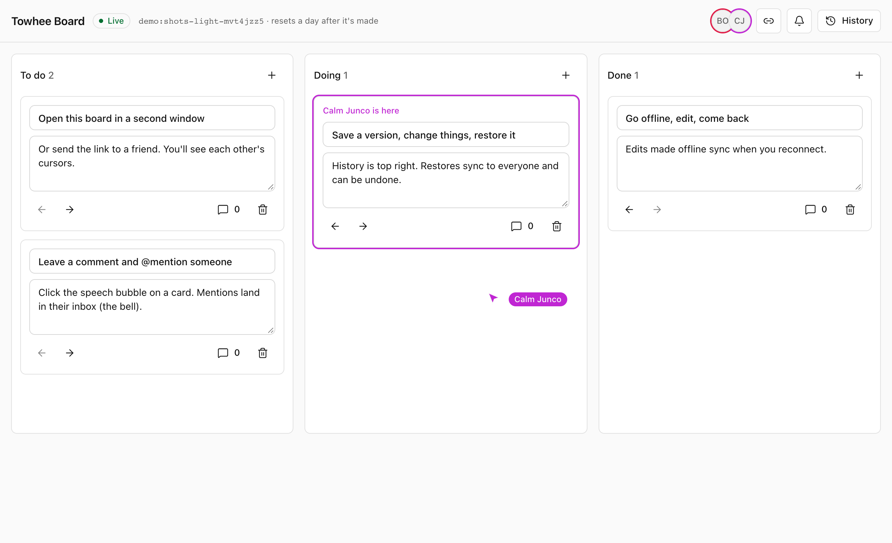

<p align="center">
  <a href="https://towhee.madebytobi.com"></a>
</p>

<h1 align="center">Towhee</h1>

<p align="center"><b>Realtime collaboration you host yourself.</b><br>
Live cursors, Yjs documents, comments, version history and notifications, on your own Cloudflare account or any server that runs Docker.</p>

<p align="center">
  <a href="https://www.npmjs.com/package/@towhee/client"></a>
  <a href="https://github.com/tobibytes/towhee/pkgs/container/towhee"></a>
  <a href="https://github.com/tobibytes/towhee/actions/workflows/ci.yml"></a>
  <a href="LICENSE"></a>
</p>

<p align="center">
  <a href="https://towhee.madebytobi.com/docs">Docs</a> ·
  <a href="https://towhee.madebytobi.com/demo">Live demo</a> ·
  <a href="https://towhee.madebytobi.com/examples">Examples</a> ·
  <a href="https://junco.madebytobi.com/docs/collaboration/">UI kit</a> ·
  <a href="https://github.com/tobibytes/towhee/releases">Releases</a>
</p>

<p align="center">
  <a href="https://towhee.madebytobi.com/demo">
    <picture>
      <source media="(prefers-color-scheme: dark)" srcset="apps/site/public/screenshots/board-dark.png">
      
    </picture>
  </a>
</p>

## Why Towhee

The pieces a hosted collaboration service sells, in a server you deploy in minutes and own:

| | |
| --- | --- |
| **Presence and cursors** | Who's here, where they point, what they're editing. Identities come from your tokens. |
| **Shared documents** | A Yjs document per room that syncs live and works offline. TipTap, BlockNote and CodeMirror plug straight in. |
| **Comments** | Threads anchored to text or anything in your app, with replies, @mentions, reactions and resolve. |
| **Version history** | Automatic and named versions; restore one for everyone, as an edit that can be undone. |
| **Notifications** | An inbox per user for mentions and replies, live across tabs, plus a signed webhook for email. |
| **Yours to run** | One core, two hosts: Cloudflare Durable Objects (idle rooms cost nothing) or Node with SQLite in Docker. |

Your app keeps its users: its backend signs a short-lived token for each room, and Towhee checks it.

## Quick start

**1. Run a server**, with Docker:

```bash
export TOWHEE_SECRET="$(node -e "console.log(crypto.randomBytes(32).toString('base64url'))")"
docker run -p 8080:8080 -e TOWHEE_SECRET -v towhee-data:/data ghcr.io/tobibytes/towhee:0.1.0
```

or on Cloudflare: copy [`packages/cloudflare/template`](packages/cloudflare/template), then `npm install`, `npx wrangler secret put TOWHEE_SECRET` and `npx wrangler deploy`.

**2. Sign tokens in your backend** (`npm i @towhee/auth @towhee/protocol`), after your own session check:

```ts
import { createInboxToken, createRoomToken } from "@towhee/auth";
import { INBOX_ROOM } from "@towhee/protocol";

export async function POST(request: Request) {
  const user = await getSessionUser(request); // your auth
  if (!user) return new Response("Sign in", { status: 401 });
  const { room } = await request.json();
  const key = { id: "default", secret: process.env.TOWHEE_SECRET! };
  const token =
    room === INBOX_ROOM
      ? await createInboxToken({ userId: user.id }, key)
      : await createRoomToken({ userId: user.id, room, access: "write", user: { name: user.name } }, key);
  return Response.json({ token });
}
```

**3. Share a document** in the browser (`npm i @towhee/client`):

```ts
import { createClient } from "@towhee/client";

const client = createClient({ url: "ws://localhost:8080", authEndpoint: "/api/towhee-token" });
const room = client.enter("doc:42");
const text = room.doc.getText("body");
text.observe(() => console.log(text.toString()));
text.insert(0, "Hello from this tab. ");
```

Open it in two tabs: each sees the other's text. From here, bind an editor to `room.doc` (TipTap, BlockNote, CodeMirror), and add presence, comments, history and the inbox; React apps can use `@towhee/react`, and [Junco](https://junco.madebytobi.com/docs/collaboration/)'s `@junco/collab` draws the UI.

## Packages

| Package | | |
| --- | --- | --- |
| [`@towhee/client`](packages/client) | Browser and Node client: synced `Y.Doc`, presence, comments, history, inbox | [](https://www.npmjs.com/package/@towhee/client) |
| [`@towhee/react`](packages/react) | React providers and hooks | [](https://www.npmjs.com/package/@towhee/react) |
| [`@towhee/auth`](packages/auth) | Sign room tokens in your backend; verify webhooks | [](https://www.npmjs.com/package/@towhee/auth) |
| [`@towhee/cloudflare`](packages/cloudflare) | The server on Cloudflare: a Worker and Durable Objects | [](https://www.npmjs.com/package/@towhee/cloudflare) |
| [`@towhee/node`](packages/node) | The server on Node with SQLite; the `ghcr.io/tobibytes/towhee` image | [](https://www.npmjs.com/package/@towhee/node) |
| [`@towhee/core`](packages/core) | The engine both servers run | [](https://www.npmjs.com/package/@towhee/core) |
| [`@towhee/protocol`](packages/protocol) | Wire protocol and shared types | [](https://www.npmjs.com/package/@towhee/protocol) |

Ready-made UI (avatar stack, cursors, comments, history, inbox) lives in [Junco](https://junco.madebytobi.com/docs/collaboration/) as `@junco/collab`, with a Towhee adapter. The site and demo in [`apps/site`](apps/site) are built with it.

## Docs

- [Quick start and overview](https://towhee.madebytobi.com/docs)
- [Using the client](https://towhee.madebytobi.com/docs/client) · [React](https://towhee.madebytobi.com/docs/react) · [Tokens and access](https://towhee.madebytobi.com/docs/tokens)
- [Deploy on Cloudflare](https://towhee.madebytobi.com/docs/cloudflare) · [Run with Docker or Node](https://towhee.madebytobi.com/docs/docker) · [Managing Towhee](https://towhee.madebytobi.com/docs/managing)
- [Endpoints, limits and errors](https://towhee.madebytobi.com/docs/reference)

## Contributing

```bash
pnpm install
pnpm build
pnpm test
pnpm typecheck
pnpm lint
```

Node 22.18 or newer. The plan is in [docs/PLAN.md](docs/PLAN.md), the build order in [docs/SESSIONS.md](docs/SESSIONS.md) and the release process in [docs/RELEASING.md](docs/RELEASING.md). Add a changeset (`pnpm changeset`) when a package changes.

## License

[MIT](LICENSE) © Oluwatobi Olajide
